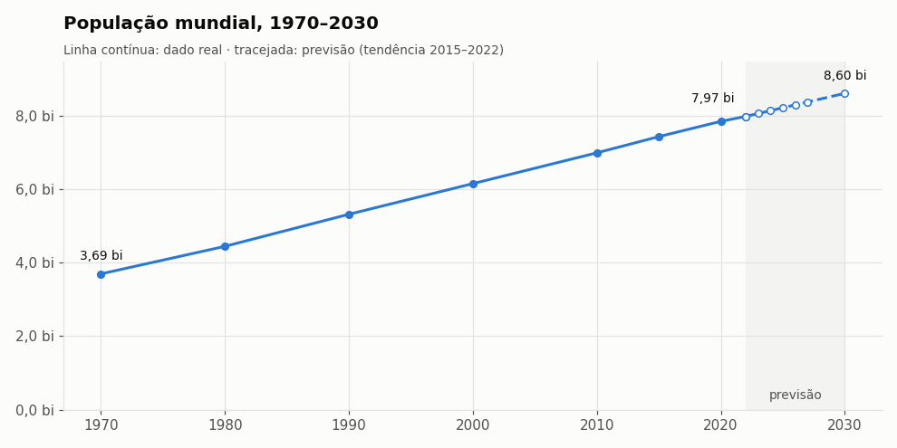

# Projeto Forecast

Previsão populacional por país a partir da base *World Population* (populações de 1970 a 2022 para 234 países e territórios).

## Etapas

| Notebook | Descrição |
|---|---|
| [`01_ingestao.ipynb`](01_ingestao.ipynb) | Carrega o CSV, inspeciona estrutura, nulos e duplicados |
| [`02_limpeza.ipynb`](02_limpeza.ipynb) | Corrige `Density` e `Growth Rate`, padroniza colunas e exporta a base limpa |
| [`03_forecast.ipynb`](03_forecast.ipynb) | Backtest de métodos (treino até 2015, teste em 2020/2022) e previsão por país ano a ano (2023–2027) e para 2030 |
| [`04_graficos.ipynb`](04_graficos.ipynb) | Gráficos do histórico e das previsões (salvos em `figuras/`) |
| [`05_idosos.ipynb`](05_idosos.ipynb) | Ranking de crescimento 2000–2022 cruzado com a população de 65+ do Banco Mundial |
| [`06_powerbi.ipynb`](06_powerbi.ipynb) | Junta as saídas em modelo estrela e salva em Parquet (`data/powerbi/`) para o dashboard do Power BI ([guia](POWERBI.md)) |

## Resultados

- Método escolhido: tendência linear entre os dois últimos pontos observados (erro mediano de 1,75% no teste de 2022, contra 7,96% da previsão ingênua).
- População mundial prevista: **8,05 bi em 2023**, **8,13 bi em 2024**, **8,21 bi em 2025**, **8,29 bi em 2026**, **8,37 bi em 2027** e **8,60 bi em 2030** (crescimento de ~0,95% ao ano).

Decisões e histórico do projeto: [`HISTORICO.md`](HISTORICO.md).

- **Idosos:** o número de pessoas com 65+ cresceu em 213 de 214 países de 2000 a 2022, e a fatia de idosos em 191 (89%). Os países que mais encolheram são os mais envelhecidos (mediana de 20,4% de idosos, contra 2,7% nos que mais cresceram).



## Dados

- `data/world_population.csv`: base original (separador `;`)
- `data/world_population_limpo.csv`: base tratada, gerada pelo `02_limpeza.ipynb`
- `data/forecast_populacao.csv`: previsões para 2025 e 2030, geradas pelo `03_forecast.ipynb`
- `data/forecast_anual_2022_2027.csv`: população e crescimento % ano a ano de 2022 (real) a 2027, gerada pelo `03_forecast.ipynb`
- `data/idosos_65mais_banco_mundial.csv`: população com 65+ (pessoas e %) por país, 1970–2024, do Banco Mundial
- `data/crescimento_e_idosos_2000_2022.csv`: crescimento populacional e de idosos por país, gerada pelo `05_idosos.ipynb`
- `data/powerbi/*.parquet`: tabelas do dashboard (`dim_pais`, `dim_ano`, `fato_populacao`, `fato_idosos`, `fato_crescimento_idosos`), geradas pelo `06_powerbi.ipynb`

## Como executar

```bash
pip install pandas pyarrow jupyter
jupyter notebook
```

Execute os notebooks em ordem, a partir da pasta `Projeto_Forecast`.
